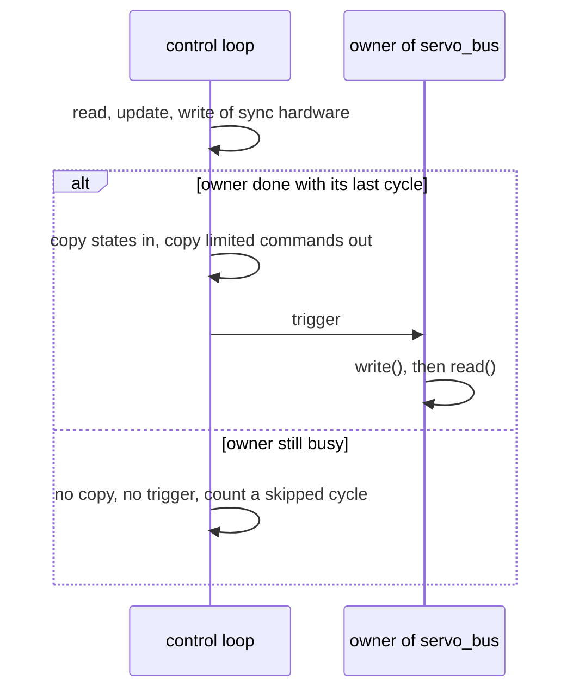

# Sync and async hardware

A sync component is read and written by the control loop. An async component is read and written by
its own owner thread, which the control loop triggers once per cycle.

```xml
<ros2_control name="servo_bus" type="system" is_async="true">
  <properties>
    <async thread_priority="60" affinity="[2]"/>
  </properties>
  ...
</ros2_control>
```



RT copies only while the owner is free, so a controller sees all joints of one `read` and one
`write` applies all joints of one `update`. At most one cycle is outstanding. While the owner stays
busy the controllers keep the last states, the cycle counts as skipped, and with `print_warnings`
(the default) hcm logs it once per diagnostics period.

## Trade off

Async buys isolation. A bus call that blocks stalls only its component, which faults after
`hardware_hang_timeout_ms` while a controller uses it, and two buses transfer in parallel. A
blocking sync `read` or `write` stalls the whole control loop.

Async costs freshness and flexibility. The states a controller sees were read after the previous
write, up to one period older than a sync read. An async component may export only double
interfaces. Choose async for a slow or blocking bus, sync for plugins that only touch memory, such
as mock hardware or a simulator.

## Scheduling

On a realtime kernel the owner runs SCHED_FIFO at the `thread_priority` of `<async>`, else of the
`<ros2_control>` tag. The parser cannot tell an explicit 50 from no value, so 50 runs one below the
control loop. `affinity` pins the owner to cores.
