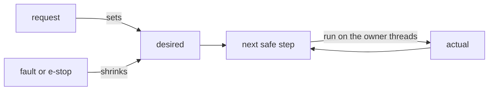

# Desired and actual state

hcm keeps a **desired** state, which controllers should be active and which state each hardware
component should be in, and an **actual** state, what each one is in now. A request changes desired.
A single supervisor thread then repeats one step until actual matches desired, the request's
deadline passes, or only a hung call is left.

Each step is chosen from the current actual state, so a fault that arrives halfway through a switch
is taken into account before the next step. Steps run in a fixed priority, holds and stops before
starts, and each one leaves the robot in a consistent state.

Failures only shrink desired. A failed step removes the failed controller from desired, together
with every controller chained to it, so nothing is retried. A failed switch rolls back by setting
desired to the state before the request, minus what a fault stopped meanwhile, and reconciling
again. Its answer is `Switch failed and was rolled back` with the reason of each failed call.

Requests run one at a time in FIFO order. A shutdown goes ahead of the waiting ones. Without a
request the supervisor finishes leftover work, such as fault handling, and yields as soon as a
request arrives.

## Quarantine

A plugin call that outlives its deadline is given up but keeps running on its owner thread. Its
controller or component is quarantined until the call returns. Nothing claims what it holds, and a
switch that does not touch it still succeeds. A late return is applied like any other outcome.
